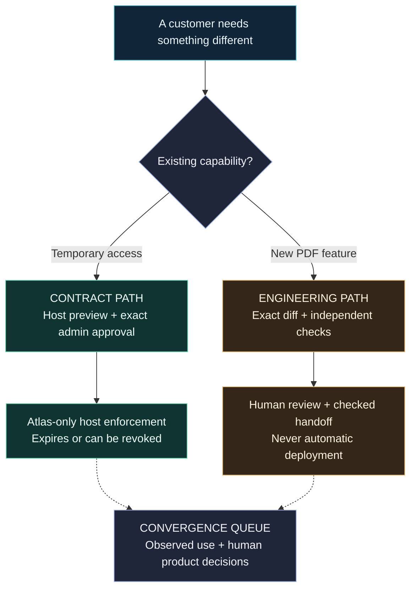

<div align="center">

# OwnStack

### Adapt the edge. Keep the core.

Customer-specific changes for B2B software.<br>
One shared app. Explicit boundaries. Human control.

[The story](#it-starts-with-one-small-request) · [How it works](#two-paths-one-rule) · [Run locally](#run-it-locally-with-ai-off) · [Evidence](#show-the-work-not-just-the-interface) · [Architecture](#inside-the-system)

</div>

---

> **Repository publication status:** this GitHub repository currently contains the project overview only. The Python/React implementation, evidence files and MIT license file have not been uploaded here. Results below describe the local reference build; cloning this repository alone will not run it.

## It starts with one small request

> “Give this contractor read-only access to Project Atlas until Friday.”

It sounds like a permission change. Until someone asks the questions that matter.

Which contractor? Which project? Who approved it? What happens on Saturday? Does another customer inherit the change? Can anyone explain exactly what happened afterward?

Then another request arrives:

> “Can you add PDF export for our workspace?”

That is not the same kind of change. A permission can be bounded by an existing capability. A missing feature needs engineering.

**OwnStack makes that distinction real.** It helps an owned sample application adapt to a customer's needs without turning every request into a permanent fork, an unrestricted model action, or a configuration flag that quietly becomes a new product.

The idea is simple: the model can suggest a change. It does not get to decide what the application permits.

> **Status · October 19, 2026:** working local reference implementation with synthetic Atlas and Nova tenants. Historical live Nemotron access workflow observed; current rehearsal runs with AI off. Not a hosted product, production-certified sandbox, validated business or completed hackathon submission.

## Two paths. One rule.

**The host application remains the final authority.**



### Path 1: a change the app already knows how to make

The Capability Contract describes one narrow effect: temporary, read-only access for one viewer, in one project, in one tenant, for at most seven days.

The host computes a preview using its authorization logic. An authenticated admin approves the exact proposal, not a paraphrase or an earlier revision. The host then checks tenant, project, viewer, expiry and revocation on each protected read.

Atlas changes. Nova does not. When the grant expires or is revoked, the next read is denied.

### Path 2: a change that really needs code

PDF export cannot be disguised as a permission setting. It becomes an engineering work item with an inspectable request, exact diff, failed and passing evidence, and an explicit human decision.

A bounded repair workflow uses LangGraph to route scope checks and parallel artifact/snapshot reviews. PostgreSQL owns durable state and recovery; the graph does not introduce a second checkpoint authority.

Candidate code runs separately from the trusted PDF oracle. A passing result must cover the exact patch and current verification policy. Even then, acceptance produces a manual-release handoff, **not a merge or deployment**.

### When the same need keeps returning

The Convergence Queue connects repeated needs with recorded variation use. A product owner can promote, keep separate or retire a variation with a rationale. The decision is recorded; it does not automatically release a feature or reveal another tenant's request text.

## Built for the moment something goes wrong

The interesting part is not the happy-path animation. It is what happens when systems disagree.

| When this happens | OwnStack's boundary |
| --- | --- |
| The same request is submitted again | Idempotency shares saved work; conflicting intent is rejected. |
| A page is refreshed | Saved state is read without dispatching another model call. |
| An attempt times out | The local wait ends honestly; remote cancellation is not claimed. |
| Attempt 1 answers after attempt 2 takes ownership | Acceptance fences discard the stale answer. |
| A proposal or checked artifact changes | Exact hashes, revisions and provenance require fresh evidence. |
| The model is unavailable | Engineers retain evidence and can continue manually. |
| Candidate code prints “passed” and exits successfully | The external oracle still requires actual, valid PDF output. |
| A human accepts a checked patch | The release state remains Not deployed. |

A preview is not an observation. A patch is not a release. A test pass is not a security guarantee.

## Inside the system

| Component | What it owns | Implementation |
| --- | --- | --- |
| Studio | Requests, scoped review, saved progress, evidence and optional 3D illustration | React 19, TypeScript, Three.js |
| Control API | Sessions, roles, proposal approval and tenant-scoped routes | Python, FastAPI |
| Host application | Final authorization on protected reads | Owned Python project-workspace fixture |
| Durable ledger | Requests, attempts, approvals, variations, evidence, events and outbox | PostgreSQL, SQLAlchemy, Alembic |
| Repair worker | Bounded phase execution, retries and stale-result fencing | Python, LangGraph |
| Model adapter | Server-side interpretation and bounded patch proposals | NVIDIA Nemotron through Nebius Token Factory |
| Verifier | Restricted candidate execution and independent output checks | Linux, Docker, Landlock, seccomp, external PDF oracle |
| Delivery layer | Local reverse proxy and optional TLS configuration | Nginx, Docker Compose, Caddy configuration |

The optional 3D view explains the architecture. It is not live permission telemetry, an approval control or evidence that a request succeeded.

## Show the work, not just the interface

These are **recorded local results**, not a live CI badge or an independent security audit.

| Checkpoint | Recorded result | What it does not establish |
| --- | --- | --- |
| Security revision, Oct 18 | 416 Python tests, 26 frontend tests and web build pass | Production correctness or exhaustive coverage |
| Kernel-denial controls | 15 authored probes pass on each verifier backend, each also producing a valid seven-case PDF | Fifteen novel escapes, VM-grade isolation or arbitrary-code safety |
| Adversarial verifier matrix | 13 disposable-container and 15 sidecar expectations match | General PDF correctness or sandbox certification |
| Hardened HTTP journey | 33 checks across 80 requests, including tenant boundaries, expiry, revoke and manual PDF recovery | Customer adoption or 80 independent attack scenarios |
| Service restart | 12 checks across 18 requests; three saved histories match | Machine-loss recovery or database failover |
| Logical PostgreSQL restore | 24 tables and 743 rows match the frozen snapshot | Cluster-role recovery, physical backup or production RPO/RTO |
| Historical graph comparator | 16 cases × 2 engines × 3 repetitions = 96 executions; 48 paired outcomes match | 96 unique scenarios or improved model quality |

The graph comparator belongs to an earlier source revision. Its local p95 was 8.661 ms versus 7.566 ms for the simpler controller: added orchestration overhead, not a speedup. Later security tests do not silently rebind that benchmark.

### The model did not get a free pass

On October 7, a live NVIDIA Nemotron call through Nebius Token Factory interpreted the access request. Exact approval led to a real Atlas host read, Nova denial and revocation.

The live PDF patch failed independent checks. Its failure remains recorded. A subsequent manual-path correction passed checks, but that is **not** a successful model-only implementation. Later offline demonstrations use handwritten fixtures and identify them accordingly.

Current inference is paused. The original ten-call allowance is exhausted; no counter reset or fresh database grants permission to spend again. Saved evidence and manual workflows remain usable.

The implementation's documentation includes the security methodology, validation ledger, live-usage records, graph comparison and source-revision qualifications. These files will accompany source publication; they are not yet available in this overview-only repository.

## Run it locally with AI off

Use the **complete Python/React reference source**, not the older README-only prototype repository. The following commands are for a first local setup, not an instruction to replace an existing private rehearsal.

Prerequisites: Docker Desktop with Compose and Linux containers. Candidate verification requires Linux x86_64 or aarch64, Landlock ABI 3 or later and libseccomp. The measured security run used aarch64 with ABI 8. Missing support fails closed instead of falling back to unrestricted execution.

From the source directory containing `compose.full.yaml`, explicitly disable inference in the current shell:

```bash
export OWNSTACK_AI_MODE=off
export OWNSTACK_MAX_LIVE_CALLS=0
export NEBIUS_API_KEY=
export NEBIUS_MODEL_ID=
export NEBIUS_PATCH_MODEL_ID=

docker compose -f compose.full.yaml up -d --build
curl -fsS http://127.0.0.1:8080/health/ready
```

Wait for startup and migrations. Expected readiness:

```json
{"status":"ready","ai_mode":"off"}
```

Open **http://127.0.0.1:8080**. Local synthetic identities are `atlas-admin`, `atlas-engineer`, `atlas-contractor`, `nova-admin`, `nova-contractor` and `platform-owner`. On a new default fixture, their password is `demo-only-pass`.

**Never expose these credentials or this default stack publicly.** Existing environments may use different credentials. Local setup is not a production deployment.

The full stack starts PostgreSQL, migrations, API, worker, web and the no-network verifier. Readiness checks the schema and required worker/verifier signals without making an inference call.

<details>
<summary><strong>Development checks and source navigation</strong></summary>

For host-side development, use Python 3.12 and Node 24 with pnpm 12.6.0, matching the web container toolchain. Create a virtual environment and install the locked dependencies:

```bash
python3.12 -m venv .venv
.venv/bin/python -m pip install -c constraints.txt -e '.[dev]'
pnpm --dir web install --frozen-lockfile

.venv/bin/pytest
.venv/bin/python -m ownstack.evaluate
pnpm --dir web test
pnpm --dir web build
```

The evaluation scorecard must report `live_nebius_evaluated: false`. Unit tests use offline fixtures; they are not submission proof of live inference. The optional 3D bundle currently triggers Vite's large-chunk warning.

```text
src/ownstack/
  policy.py                Versioned contract and pure host policy
  auth.py                  Sessions, roles and CSRF
  service.py               Transactions, approval and acceptance fences
  host_access.py           Protected reads and observed grant use
  worker.py                Durable work and recovery
  repair_graph.py          Bounded evidence graph
  repair.py                Authoritative repair state and human adoption
  runner.py                Patch scope and source-bound verification
  candidate_sandbox.py     Mandatory candidate kernel restrictions
  pdf_oracle.py            Independent PDF output checks
  proof.py                 Tenant-private evidence snapshots

web/                       Studio and display-state tests
migrations/                Additive schema changes
tests/                     Python regression tests
scripts/                   Offline evaluations and operating rehearsals
docs/                      Decisions, methods, limitations and learning
```

See **deployment notes** before touching an existing environment, and **the private rehearsal guide** for its separate restricted-role setup. Do not recreate a database to recover an inference allowance.

</details>

## What is still being earned

The controls are implemented; trust has to come from more than implementation.

- **Stronger isolation:** the verifier still shares a Linux kernel and reuses its supervisor. Independent escape testing, image/supply-chain review and stronger per-job boundaries remain open.
- **Production operation:** real identity-provider integration, live TLS-path testing, sustained capacity and machine-loss recovery are not validated.
- **Product value:** no customer pilot or willingness-to-pay result yet. Compare against a competent manual/feature-flag workflow, not an artificially weak baseline.
- **Independent reproducibility:** local rehearsals are not another engineer's fresh clone, observed task study or public CI run.
- **Publication:** a judge-accessible build, public video, complete source publication and final submission remain separate gates.

OwnStack is the Nebius product. Relief is a separate project. The older shared Amazon/Alexa+ strategy is superseded.

## Explore, rebuild, contribute

When the implementation is published, start with its architecture and demo guides. Its decision log explains the tradeoffs; its open-questions ledger records what the evidence does not yet support.

The **learning plan** breaks the implementation into small, testable slices. Reconstruct them in a separate learning repository. An existing reference, passing suite or calendar date does not mark an independently completed exercise.

Useful contributions include a reproducible failure, a stronger negative test, a clearer boundary or a well-designed comparison. Describe expected behavior, observed behavior and the smallest reproduction. Keep credentials, private proof exports and customer data out of commits, screenshots and issues.

## License

The current Python/React reference implementation uses the MIT License; its license file will accompany source publication. Dependencies, models and external services retain their own terms.

---

<div align="center">

**Make room for the customer. Keep ownership of the system.**

</div>
