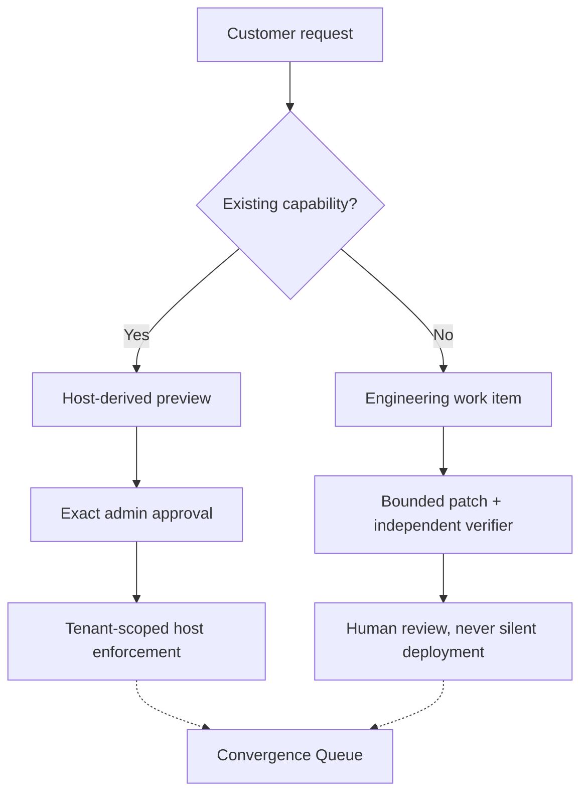

<div align="center">

# OwnStack

### Adapt the edge. Keep the core.

Customer-specific changes. One shared application. Human control.

</div>

## One request, two very different changes

> “Give this contractor read-only access to Project Atlas until Friday.”

OwnStack turns that request into a narrow, versioned Capability Contract. The
host previews the effect, an authenticated admin approves the exact proposal,
and the application enforces the temporary grant. Atlas changes. Nova does not.
Expiry and revocation are checked on protected reads.

> “Now add PDF export.”

That needs code, not a disguised configuration flag. The Engineer Cockpit keeps
the exact diff, independent checks and human decision together. A passing patch
is still **not a deployment**.



Python/FastAPI, PostgreSQL, SQLAlchemy/Alembic, LangGraph, React/TypeScript and
Three.js. NVIDIA Nemotron proposals use Nebius Token Factory when explicitly
enabled; the application and manual engineering path also work with AI off.

## Run locally with AI off

Prerequisites: Docker Desktop with Compose and Linux containers. Candidate
verification requires Linux x86_64 or aarch64, Landlock ABI 3 or later and
libseccomp. Unsupported isolation fails closed.

```bash
git clone https://github.com/usmanmohammed2306/OWNSTACK.git
cd OWNSTACK

export OWNSTACK_AI_MODE=off
export OWNSTACK_MAX_LIVE_CALLS=0
export NEBIUS_API_KEY=
export NEBIUS_MODEL_ID=
export NEBIUS_PATCH_MODEL_ID=

docker compose -f compose.full.yaml up -d --build
curl -fsS http://127.0.0.1:8080/health/ready
```

Wait for the images, migrations and background services to become ready.
Expected health response:

```json
{"status":"ready","ai_mode":"off"}
```

Open **http://127.0.0.1:8080**. Synthetic accounts:

| Account | Purpose |
| --- | --- |
| `atlas-admin` | Preview, approve and revoke Atlas access |
| `atlas-engineer` | Prepare manual proposals and inspect patches |
| `atlas-contractor` | Try the protected Atlas reads |
| `nova-admin`, `nova-contractor` | Check the separate tenant |
| `platform-owner` | Review aggregate convergence decisions |

The password for a new default fixture is `demo-only-pass`.
**These are local demo credentials. Never expose this default stack publicly.**

With AI off, use the engineer's manual handoff to prepare the request. The admin
still has to review and approve the exact access proposal. Verify the contractor's
read, then revoke access and verify denial. PDF changes follow the manual patch
and verification path, with a separate human decision.

Stop the local stack without deleting its saved data:

```bash
docker compose -f compose.full.yaml down
```

Do not delete database volumes to renew an inference allowance. The original
ten-call allowance is exhausted; this setup authorizes no provider usage.

## What is in this repository

Only the runnable application, its required assets and build configuration:

```text
src/ownstack/        Control API, host policy, worker, repair graph and verifier
web/                Studio source, frontend build and reverse proxy
migrations/         PostgreSQL schema migrations
sample_app/         Owned application targeted by bounded PDF patches
checks/             Runtime patch-check contract
docs/evidence/      Five saved JSON records read by the historical-demo screen
compose.full.yaml   Local database, API, worker, verifier and Studio
Dockerfile          Python application image
```

The JSON records and `checks/test_report.py` are runtime inputs, not disposable
documentation or the application regression suite. Removing them breaks those
features. Research reports, learning plans, test suites and experiment tooling
are not in the current runtime-only tree; earlier commits retain them.

## Explain access without impersonation

Admins and engineers can use **Why can they access this?** in Requests to check
a tenant-local viewer against the host's current policy. The inspector explains
role access, a matching temporary grant, a disabled account or denial. It does
not expose document contents, create read observations, grant access or run AI.
Results are timestamped diagnostic snapshots; actual reads always recheck policy.

**When will access change?** forecasts the next allowed/denied transition within
seven days from saved grant start/expiry boundaries, using the same pure host
policy. Overlapping or back-to-back grants do not create a false access cutoff.
The forecast assumes account, role and grants stay unchanged; it neither renews
access nor predicts future approvals. Above 128 matching grants it withholds the
forecast instead of trusting a partial schedule. Protected reads are unchanged.

## Boundaries

## Assurance workbench

Admins and engineers can open **Assurance** to inspect tenant-local saved records
without running AI or changing permissions. The catalogue lists the implemented
reports and their supported scope filters. Unsupported filters are rejected, and
foreign identifiers return not found. Identity audit reports are admin-only.

Reports default to 25 source rows, with a maximum page size of 100. Truncation is
explicit; empty or partial findings are not a clean bill of health. Nested policy
checks may inspect additional host records, so this is not a database latency cap.
Reports do not replace live authorization, independent security review or a release
decision. Private identifiers and metadata should be reviewed before sharing.

## Boundaries

### Recover from a changed host snapshot

An old preview can become invalid when host data changes. **Recover changed
proposal** lets an engineer review the current snapshot and create a new,
AI-free proposal revision with an audit reason. It preserves the original and
keeps the exact request, project, contractor and expiry unchanged. The server
rechecks the reviewed snapshot before saving, and retries share one saved result.
Unchanged previews cannot generate pointless revisions. Expired intent, changed
scope, disabled accounts and contract changes require separate resolution.

Refresh grants no access. A tenant admin must run a fresh preview and approve
the new exact proposal. The old proposal cannot authorize it. This recovery
path is separate from engineering-patch acceptance and deployment.

Studio's **Review revoke** shows the host's predicted before/after access for one
grant. It warns if another grant or role would still permit access, then requires
an acknowledgement. Reviewed revokes recheck the snapshot under project/identity
locks and reject changed state. Retries use an idempotency key. Existing direct
admin revoke API clients remain supported; this is a Studio review safeguard,
not a new universal approval requirement or proof of recalling in-flight reads.

This is a **local reference implementation**, not a hosted service or certified
production sandbox. The verifier shares a Linux kernel and reuses its supervisor.
Independent security review, production identity/TLS operation, customer validation
and final hackathon submission remain open.

The historical-demo screen shows saved synthetic results, not current permissions
or a fresh inference. Live model PDF proposals failed checks; assisted manual
recovery is not a model-only success. No new performance or full-suite claim is
made by this repository cleanup.

A preview is not an observation. A patch is not a release.
A test pass is not a security guarantee.

## License

[MIT](LICENSE). Dependencies, models and external services retain their own terms.
