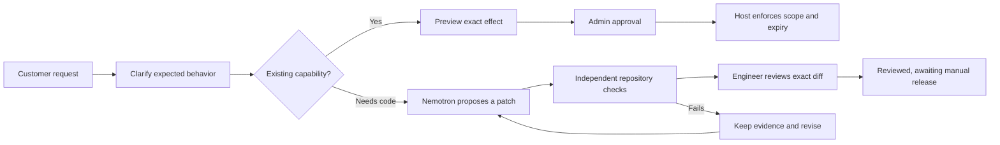

# OwnStack

### Customer changes. One shared product.

A customer asks for a small exception.

“Let this contractor read Project Atlas until Friday.”

Then another customer needs a different rule. A third asks for a new feature.
Soon, the team is maintaining a collection of flags, custom branches and promises
that ordinary tests do not understand.

OwnStack connects each customer promise to an explicit policy, a scoped change
and evidence that the shared product still behaves as agreed.



## One request, two paths

**Temporary access:** preview the actual policy effect, approve that exact proposal
and enforce it in the host app. A grant for Atlas does not authorize Nova.
Expiry, revocation and account changes are checked by the server.

**A code change:** clarify and approve the customer's expected behavior, bind it to
a repository version, propose a bounded patch and compare the baseline and
candidate against independent customer checks. Passing checks lead to review.
Acceptance records a decision; it does not merge or deploy code.

Customers have a separate portal. Engineers see their teams' work; managers see
the teams they manage. Customers receive an explicit status update without
internal code, comments or another customer's requests.

## What has been demonstrated

A real NVIDIA Nemotron Super response, served through Nebius Token Factory,
fixed an assignment regression in the owned Python sample application:

| Candidate | Passed | Failed |
| --- | ---: | ---: |
| Deliberately defective version | 138 | 9 |
| Exact Nemotron repair | 147 | 0 |

The model's source was not manually corrected. The check included tenant
isolation, assigned and unassigned people, grant start/expiry boundaries, revoked
grants and preservation of response fields. Synthetic engineer review, private
customer updates and saved-state replay were exercised afterward.

The provider response took 7.77 seconds and reported 2,891 input / 1,836 output
tokens. Its estimated token cost was $0.00252 at the observed price, not a
reconciled bill or a general performance benchmark. This is one finite synthetic
journey, not a measured success rate across arbitrary repositories.

The [recorded repair evidence](docs/evidence/customer-repair.json) includes the
exact diff, independent report digest, usage and limitations. Earlier failed
proposals remain in the historical runtime evidence.

## Run locally

Requires Docker with Compose. The default local stack uses PostgreSQL and binds
the web application to loopback.

```bash
git clone https://github.com/usmanmohammed2306/OWNSTACK.git
cd OWNSTACK

OWNSTACK_AI_MODE=off OWNSTACK_MAX_LIVE_CALLS=0 \
NEBIUS_API_KEY= NEBIUS_MODEL_ID= NEBIUS_PATCH_MODEL_ID= \
docker compose -f compose.full.yaml up -d --build

curl --fail http://127.0.0.1:8080/health/ready
```

Open **http://127.0.0.1:8080/**.

Local fixture accounts: `atlas-admin`, `atlas-engineer`, `atlas-contractor`
and the corresponding `nova-*` accounts. Their local-only passphrase is
`demo-only-pass`. Keep this fixture stack private.

To stop this checkout's stack without deleting its data:

```bash
docker compose -f compose.full.yaml down
```

The customer portal is at `/customer`. Staff create customer accounts and
invitations through the authenticated customer APIs. Customer invitations and
staff invitations are separate. Empty customer lists are not simulated customers.

### Repository comparisons

The local operator declares the supported source files, records approved customer
expectations and runs comparisons independently of the candidate. Install the
Python development dependencies below, then inspect the commands:

```bash
python scripts/customer_release.py --help
python scripts/release_assurance_operator.py --help
python scripts/change_agent_operator.py --help
```

`examples/counterexample_workspace/` contains the small owned application,
its deliberate regression and an explicitly supplied offline repair. Those
fixtures are reproducible examples, not fresh model output. Repository execution
requires Docker and the matching verifier image.

### Live AI and credit controls

Inference credentials belong on the server. Local startup above sends no model
requests. Saved results and manual engineering paths remain usable without AI.

The measured repair used an operator-authorized, one-call diagnostic transport.
That private bridge and its credentials are not part of this repository. The
ordinary repair endpoint remains gated; adding an API key does not enable
unrestricted coding or authorize additional calls. Investigation/interpretation
adapters, strict output validation and durable reservation controls are included.

Never reset a reservation ledger to obtain more calls. Configure and approve a
budget before any live run. A client timeout does not prove remote inference
was canceled.

## Development and checks

Python 3.12 and Node.js 24 are the supported development versions.

```bash
python3.12 -m venv .venv
source .venv/bin/activate
python -m pip install -c constraints.txt -e '.[dev]'
OWNSTACK_AI_MODE=off OWNSTACK_MAX_LIVE_CALLS=0 pytest --tb=short
```

```bash
cd web
corepack enable
corepack prepare pnpm@12.6.0 --activate
pnpm install --frozen-lockfile
pnpm test
pnpm build
```

Tests use controlled model responses unless a result is explicitly labeled live.
A green test suite is not a security certification or proof of customer demand.

## Structure

| Directory | Purpose |
| --- | --- |
| `src/ownstack/` | Host policy, API, durable workflows, model boundaries and verification |
| `web/` | React/TypeScript workspace and interactive Three.js views |
| `migrations/` | Versioned database changes |
| `checks/` | Independent PDF verifier contract |
| `examples/`, `sample_app/`, `sample_apps_*/` | Owned applications and deliberately failing fixtures |
| `tests/`, `web/tests/` | Backend and frontend regression checks |
| `evals/` | Evaluation inputs and source-linked repository cases |
| `scripts/`, `ops/` | Local operators, recovery checks and execution images |
| `training/` | Small planner training/evaluation code and synthetic data |
| `docs/evidence/` | Runtime-read historical observations, including failures |

The planner experiment uses supervised LoRA on a small Qwen model. It is separate
from the runtime NVIDIA Nemotron integration. Training requires its own
`training/requirements.txt` environment and compute; it does not run during
startup or tests. Trained weights and private account records are not bundled.

## Boundaries

This is a locally verified release candidate, not a production security guarantee.
Repository execution supports bounded Python profiles. External SSO, generic remote
CI enforcement, independently assessed hostile-code isolation and production
failover are not established. Docker restrictions are not a certified sandbox.

The hosted preview can differ from this source. Customer savings and willingness
to pay remain hypotheses; the accounts and organizations used in tests are
synthetic. There is no automatic promotion of customer-specific changes into the
shared product.

## License

[MIT](LICENSE).
