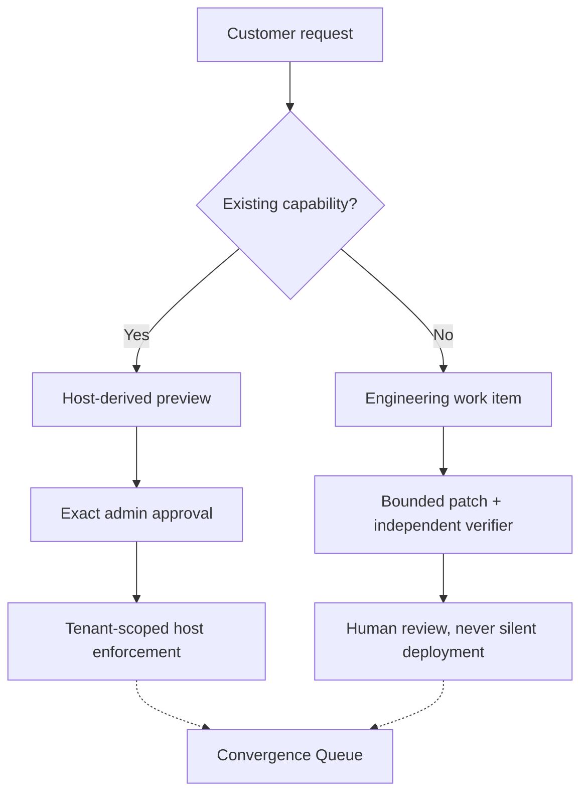

<div align="center">

# OwnStack

### Adapt the edge. Keep the core.

Customer-specific changes. One shared application. Human control.

</div>

## One request, two very different changes

> “Give this contractor read-only access to Project Atlas until Friday.”

OwnStack turns that request into a narrow, versioned Capability Contract. The
host previews the effect, an authenticated admin approves the exact proposal,
and the application enforces the temporary grant. Atlas changes. Nova does not.
Expiry and revocation are checked on protected reads.

> “Now add PDF export.”

That needs code, not a disguised configuration flag. The Engineer Cockpit keeps
the exact diff, independent checks and human decision together. A passing patch
is still **not a deployment**.



Python/FastAPI, PostgreSQL, SQLAlchemy/Alembic, LangGraph, React/TypeScript and
Three.js. NVIDIA Nemotron proposals use Nebius Token Factory when explicitly
enabled; the application and manual engineering path also work with AI off.

## Run locally with AI off

Prerequisites: Docker Desktop with Compose and Linux containers. Candidate
verification requires Linux x86_64 or aarch64, Landlock ABI 3 or later and
libseccomp. Unsupported isolation fails closed.

```bash
git clone https://github.com/usmanmohammed2306/OWNSTACK.git
cd OWNSTACK

export OWNSTACK_AI_MODE=off
export OWNSTACK_MAX_LIVE_CALLS=0
export NEBIUS_API_KEY=
export NEBIUS_MODEL_ID=
export NEBIUS_PATCH_MODEL_ID=

docker compose -f compose.full.yaml up -d --build
curl -fsS http://127.0.0.1:8080/health/ready
```

Wait for the images, migrations and background services to become ready.
Expected health response:

```json
{"status":"ready","ai_mode":"off"}
```

Open **http://127.0.0.1:8080**. Synthetic accounts:

| Account | Purpose |
| --- | --- |
| `atlas-admin` | Preview, approve and revoke Atlas access |
| `atlas-engineer` | Prepare manual proposals and inspect patches |
| `atlas-contractor` | Try the protected Atlas reads |
| `nova-admin`, `nova-contractor` | Check the separate tenant |
| `platform-owner` | Review aggregate convergence decisions |

The password for a new default fixture is `demo-only-pass`.
**These are local demo credentials. Never expose this default stack publicly.**

With AI off, use the engineer's manual handoff to prepare the request. The admin
still has to review and approve the exact access proposal. Verify the contractor's
read, then revoke access and verify denial. PDF changes follow the manual patch
and verification path, with a separate human decision.

Stop the local stack without deleting its saved data:

```bash
docker compose -f compose.full.yaml down
```

Do not delete database volumes to renew an inference allowance. The original
ten-call allowance is exhausted; this setup authorizes no provider usage.

## What is in this repository

Only the runnable application, its required assets and build configuration:

```text
src/ownstack/        Control API, host policy, worker, repair graph and verifier
web/                Studio source, frontend build and reverse proxy
migrations/         PostgreSQL schema migrations
sample_app/         Owned application targeted by bounded PDF patches
checks/             Runtime patch-check contract
docs/evidence/      Five saved JSON records read by the historical-demo screen
compose.full.yaml   Local database, API, worker, verifier and Studio
Dockerfile          Python application image
```

The JSON records and `checks/test_report.py` are runtime inputs, not disposable
documentation or the application regression suite. Removing them breaks those
features. Research reports, learning plans, test suites and experiment tooling
are not in the current runtime-only tree; earlier commits retain them.

## Boundaries

This is a **local reference implementation**, not a hosted service or certified
production sandbox. The verifier shares a Linux kernel and reuses its supervisor.
Independent security review, production identity/TLS operation, customer validation
and final hackathon submission remain open.

The historical-demo screen shows saved synthetic results, not current permissions
or a fresh inference. Live model PDF proposals failed checks; assisted manual
recovery is not a model-only success. No new performance or full-suite claim is
made by this repository cleanup.

A preview is not an observation. A patch is not a release.
A test pass is not a security guarantee.

## License

[MIT](LICENSE). Dependencies, models and external services retain their own terms.
